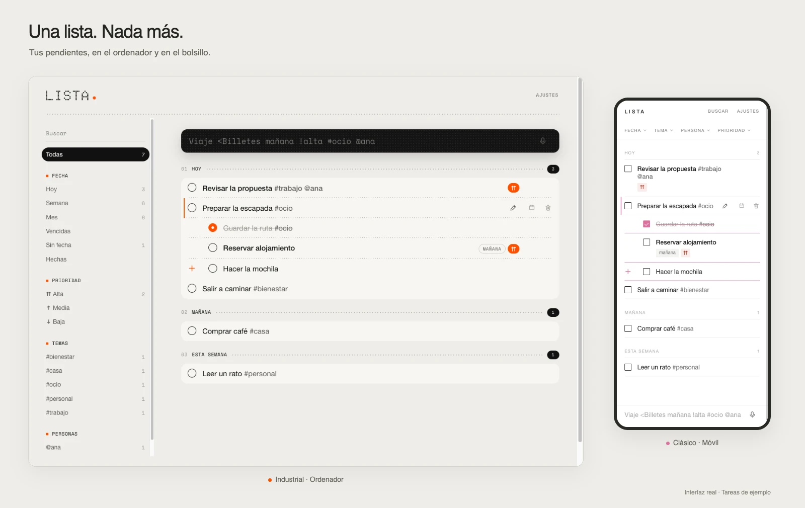

<p align="center">
  
</p>

<h1 align="center">Lista</h1>

<p align="center">
  <strong>Una lista. Nada más.</strong><br>
  Escribe lo que tienes en la cabeza. Lista lo pone en su sitio.
</p>

<p align="center">
  <a href="https://lista-7bi.pages.dev/"><strong>Abrir Lista</strong></a>
  · <a href="#escribe-como-piensas">Cómo se usa</a>
  · <a href="#desarrollo">Desarrollo</a>
</p>

<p align="center">
  
</p>

<p align="center">
  <sub>Sin cuenta para empezar · Funciona sin conexión · iPhone, Android y ordenador</sub>
</p>

## Escribe como piensas

Una tarea, una línea. Las fechas, las etiquetas y las prioridades van contigo.

```text
Llamar mañana #trabajo @ana !alta
```

| Para añadir… | Escribe… |
|---|---|
| Una fecha | `hoy`, `mañana`, `el viernes`, `15 nov` |
| Un periodo | `esta semana`, `este mes`, `este trimestre` |
| Un tema o una persona | `#trabajo`, `@ana` |
| Una prioridad | `!alta`, `!media`, `!baja` |
| Una repetición | `cada lunes`, `cada 2 martes`, `cada dos semanas`, `quincenal`, `cada mes`, `a diario` |
| Una subtarea | `<Reservar alojamiento` |

Pulsa **Enter** para guardarla. También puedes dictar con el micrófono, una tarea tras otra.
Al empezar a escribir desaparece el ejemplo, pero queda una guía discreta de las opciones.

## Divide lo grande en pasos

Añade subtareas con `<`, sin salir del campo de escritura:

```text
Viaje <Billetes mañana !alta <Mochila
```

Una tarea principal, dos subtareas. Cada paso puede tener su propia fecha, prioridad y etiquetas.
La principal lleva un icono de ramas con los pasos hechos (`1/2`): púlsalo para desplegarlos y plegarlos. Cada grupo se queda como lo dejaste, también al volver, y **los pasos siguen en su sitio aunque los marques**. Tocar el título edita la tarea, como en cualquier otra.

<details>
<summary>Más sobre las subtareas</summary>

- Para añadir pasos a una tarea existente, pulsa **+ Subtarea** en su editor o el **+** junto a la casilla de la última subtarea del grupo desplegado.
- Ahí cada **Enter** guarda ese paso al momento y deja el campo listo para el siguiente; **Enter** en vacío o **Listo** cierra. **Cancelar** solo descarta lo que estés escribiendo.
- Completar la principal cierra todos sus pasos; completar el último paso cierra la principal.
- Reabrir un paso reabre la principal. Reabrir la principal reabre todos sus pasos.
- **Deshacer** recupera el estado anterior, sin reabrir pasos que ya estaban hechos.
- En Clásico, un grupo cerrado se reconoce por el subrayado del color secundario. Al desplegarlo, ese color aparece en las líneas inferiores de sus subtareas, los **+** y las casillas y tachados de los pasos completados.

</details>

## Hazla, táchala, sigue

- **Completa o borra.** Desliza a la derecha para tachar; a la izquierda para borrar.
- **Encuentra lo importante.** Toca un tema, una persona o una fecha para filtrar.
- **Cada cosa en su día.** Las tareas se agrupan en Vencidas, Hoy, Mañana, Esta semana y Próximas. Las vencidas se ven siempre arriba, filtres por la fecha que filtres.
- **Tu semana de un vistazo.** Arriba de los filtros (en el móvil, al tocar **Buscar**) verás cuántas tareas tienes hoy, las vencidas y cuántas tareas tienes cada uno de los próximos 7 días. Toca un día para ver solo sus tareas (y las vencidas); tócalo otra vez (o vuelve a abrir Lista) para verlas todas.
- **Cambia de planes.** Toca una tarea para editarla: se guarda sola al pulsar Enter o al salir. Mientras la editas, la casilla se convierte en el asa ⠿: arrástrala a otro bloque (Hoy, Mañana, Esta semana…) para cambiarla de día. Debajo tienes **+ Subtarea**, **Calendario** y **Borrar**. Con teclado, **M** la pasa a mañana.
- **Deshacer con el teclado.** **⌘Z** (Ctrl+Z en Windows) deshace el último cambio de la lista —completar, borrar, mover—, y repetido, los anteriores. Dentro de un campo de texto sigue deshaciendo lo escrito.
- **Para mañana.** Arrastra la tarea al bloque **Mañana** (en ordenador, también **m** con la tarea seleccionada); **Deshacer** la devuelve a su fecha anterior.
- **Abre los enlaces.** Una dirección web en una tarea se muestra corta; tócala para abrirla.

## A tu manera

**Dos estilos, la misma calma.** Clásico, en blanco y negro; Industrial, con gris cálido, letra de puntos y acento naranja. Ambos con tema claro, oscuro o el del sistema.

**Un toque de color.** En **Ajustes → Apariencia**, Clásico permite elegir un color secundario: rosa (por defecto), azul, verde, naranja o uno personalizado. Industrial conserva su naranja y no muestra la paleta; tu elección se guarda para cuando vuelvas a Clásico.

**Solo lo que seleccionas.** La línea izquierda marca únicamente la fila seleccionada. Clásico usa el color secundario para las tareas con subtareas y sus pasos; Industrial, su naranja.

**Qué versión llevas.** Al pie de **Ajustes**, junto a la firma, aparecen la versión, el día y la hora en que se compiló y el commit. Sirve para comprobar que tienes lo último tras una actualización.

**En español o en inglés.** Lista sale en español si tu navegador lo tiene entre sus idiomas; si no, en inglés. Puedes cambiarlo en **Ajustes → Apariencia → Idioma · Language**. En inglés todo cambia: la bienvenida, los menús y también lo que escribes (`tomorrow`, `every 2 tuesdays`, `!high`, `due:2026-11-15`). El nombre, Lista, no se traduce.

**Igual en todos tus dispositivos.** Con la misma cuenta, el tema, el estilo, el color y el idioma se sincronizan. Si cambias algo sin conexión, se envía al volver; ante cambios simultáneos gana el más reciente.

## Tus tareas, contigo

Todo se guarda primero **en tu dispositivo**. Puedes usar Lista sin cuenta y sin conexión;
si quieres llevar tus tareas del móvil al ordenador, entra con **Google**.
Desde **Ajustes → Tus datos** puedes exportarlo todo o borrarlo todo.

Para tenerla siempre a mano, instálala como una app:

- **iPhone:** Compartir → Añadir a pantalla de inicio.
- **Android y ordenador:** Instalar app desde el navegador.

---

## Desarrollo

Vite · TypeScript · Preact · Dexie / IndexedDB · Supabase · Cloudflare Pages.

Con **Node.js 22**:

```bash
npm ci
npm run dev     # http://localhost:5173
```

Sin configurar nada más, funciona en local sin sincronización.

<details>
<summary>Tests, cobertura y build</summary>

```bash
npm test
npm run test:coverage
npm run build
```

La cobertura incluye todo `src/` y genera informes LCOV y JSON en `coverage/`, excluidos de Git.

</details>

<details>
<summary>Sincronización con Supabase (opcional)</summary>

1. Crea un proyecto en Supabase y ejecuta [`supabase/schema.sql`](supabase/schema.sql).
2. Copia [`.env.example`](.env.example) a `.env` con `VITE_SUPABASE_URL` y `VITE_SUPABASE_ANON_KEY`.
3. Activa Google en *Authentication → Providers* y añade tu URL en *Redirect URLs*. Desactiva el proveedor *Email*: la app solo entra con Google.

**Si ya tenías una instalación:** para sincronizar la apariencia, ejecuta la [migración de ajustes](supabase/migrations/20261029_appearance_settings.sql) en el SQL editor, o vuelve a ejecutar el esquema. Utiliza el tipo `setting`, sin duplicar preferencias ni cambiar las políticas por usuario. Un servidor antiguo rechazará los envíos de apariencia hasta actualizarlo.

**Límites del servidor:** ejecuta la [migración de límites](supabase/migrations/20261101_limites.sql) en el SQL editor, o vuelve a ejecutar el esquema. Añade un tope de 64 KiB por registro y borra cada 15 minutos los enlaces entre dispositivos caducados (con pg_cron, si el proyecto lo tiene disponible).

La apariencia guardada en el dispositivo se migra una sola vez, sin sobrescribir una elección ya sincronizada. Si varios dispositivos tenían elecciones antiguas distintas, convergen en la aceptada por el servidor. Al actualizar, la base local fuerza una descarga completa para recuperar preferencias que una versión anterior pudo ignorar.

</details>

<details>
<summary>Arquitectura y despliegue</summary>

- **Local-first:** cada cambio se guarda al instante y se sincroniza en segundo plano. Ante conflictos gana el más reciente.
- **Datos separados por usuario:** RLS en Supabase.
- **Sin conexión:** service worker propio, con actualización automática.
- **Recursos locales:** fuentes incluidas en la app y CSP estricta.

| Carpeta | Contenido |
|---|---|
| `src/parser/` | Interpreta lo que escribes |
| `src/data/` | Base de datos local |
| `src/sync/` | Sincronización con Supabase |
| `src/ui/` | Pantallas y estilos |
| `src/pwa/` | Service worker |

Cada merge a `main` ejecuta los tests y publica en Cloudflare Pages mediante [`deploy.yml`](.github/workflows/deploy.yml). Necesita `CLOUDFLARE_API_TOKEN` y `CLOUDFLARE_ACCOUNT_ID`, además de los secretos de Supabase si usas sincronización.

</details>

<p align="center">
  <sub>Código Do Norte ♥ Coruña</sub>
</p>
