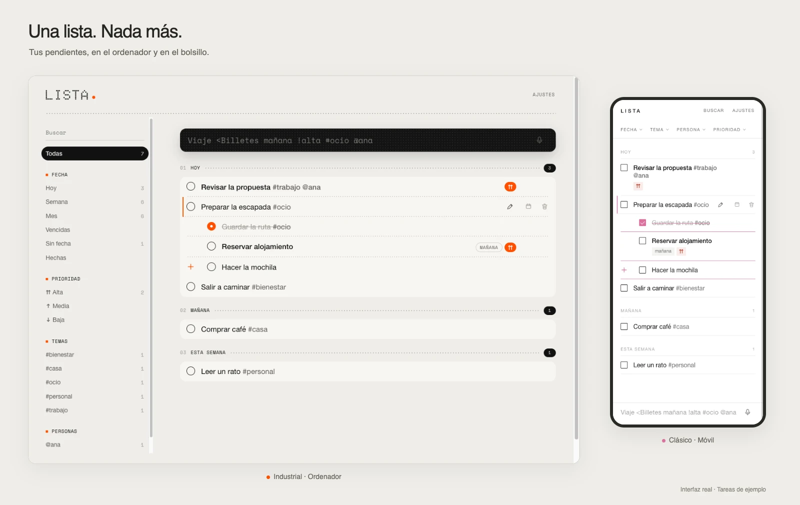

<p align="center">
  
</p>

<h1 align="center">Lista</h1>

<p align="center">
  <strong>Una lista. Nada más.</strong><br>
  Escribe lo que tienes en la cabeza. Lista lo pone en su sitio.
</p>

<p align="center">
  <a href="https://lista-7bi.pages.dev/"><strong>Abrir Lista</strong></a>
  · <a href="#escribe-como-piensas">Cómo se usa</a>
  · <a href="#desarrollo">Desarrollo</a>
</p>

<p align="center">
  
</p>

<p align="center">
  <sub>Sin cuenta para empezar · Funciona sin conexión · iPhone, Android y ordenador</sub>
</p>

## Escribe como piensas

Una tarea, una línea. Las fechas, las etiquetas y las prioridades van contigo.

```text
Llamar mañana #trabajo @ana !alta
```

| Para añadir… | Escribe… |
|---|---|
| Una fecha | `hoy`, `mañana`, `el viernes`, `15 nov` |
| Un periodo | `esta semana`, `este mes`, `este trimestre` |
| Un tema o una persona | `#trabajo`, `@ana` |
| Una prioridad | `!alta`, `!media`, `!baja` |
| Una repetición | `cada lunes`, `cada mes`, `a diario` |
| Una subtarea | `<Reservar alojamiento` |

Pulsa **Enter** para guardarla. También puedes dictar con el micrófono, una tarea tras otra.
Al empezar a escribir desaparece el ejemplo, pero queda una guía discreta de las opciones.

## Divide lo grande en pasos

Añade subtareas con `<`, sin salir del campo de escritura:

```text
Viaje <Billetes mañana !alta <Mochila
```

Una tarea principal, dos subtareas. Cada paso puede tener su propia fecha, prioridad y etiquetas.
Toca el título de la principal para desplegarlos: **se quedan en su sitio aunque los marques**.

<details>
<summary>Más sobre las subtareas</summary>

- Para añadir pasos a una tarea existente, pulsa **+** en su editor o junto a la casilla de la última subtarea del grupo desplegado.
- En esos campos, **Enter** con texto abre el siguiente; **Enter** en uno vacío guarda los pasos. También puedes pulsar **Añadir subtareas**.
- Completar la principal cierra todos sus pasos; completar el último paso cierra la principal.
- Reabrir un paso reabre la principal. Reabrir la principal reabre todos sus pasos.
- **Deshacer** recupera el estado anterior, sin reabrir pasos que ya estaban hechos.
- En Clásico, un grupo cerrado se reconoce por el subrayado del color secundario. Al desplegarlo, ese color aparece en las líneas inferiores de sus subtareas, los **+** y las casillas y tachados de los pasos completados.

</details>

## Hazla, táchala, sigue

- **Completa o borra.** Desliza a la derecha para tachar; a la izquierda para borrar.
- **Encuentra lo importante.** Toca un tema, una persona o una fecha para filtrar.
- **Cada cosa en su día.** Las tareas se agrupan en Vencidas, Hoy, Mañana, Esta semana y Próximas.
- **Cambia de planes.** Selecciona una tarea y arrastra **Mover** para cambiarla de día; usa el lápiz para editarla.

## A tu manera

**Dos estilos, la misma calma.** Clásico, en blanco y negro; Industrial, con gris cálido, letra de puntos y acento naranja. Ambos con tema claro, oscuro o el del sistema.

**Un toque de color.** En **Ajustes → Apariencia**, Clásico permite elegir un color secundario: rosa (por defecto), azul, verde, naranja o uno personalizado. Industrial conserva su naranja y no muestra la paleta; tu elección se guarda para cuando vuelvas a Clásico.

**Solo lo que seleccionas.** La línea izquierda marca únicamente la fila seleccionada. Clásico usa el color secundario para las tareas con subtareas y sus pasos; Industrial, su naranja.

**Igual en todos tus dispositivos.** Con la misma cuenta, el tema, el estilo y el color se sincronizan. Si cambias algo sin conexión, se envía al volver; ante cambios simultáneos gana el más reciente.

## Tus tareas, contigo

Todo se guarda primero **en tu dispositivo**. Puedes usar Lista sin cuenta y sin conexión;
si quieres llevar tus tareas del móvil al ordenador, entra con **Google**.
Desde Ajustes puedes exportarlo todo o borrarlo todo.

Para tenerla siempre a mano, instálala como una app:

- **iPhone:** Compartir → Añadir a pantalla de inicio.
- **Android y ordenador:** Instalar app desde el navegador.

---

## Desarrollo

Vite · TypeScript · Preact · Dexie / IndexedDB · Supabase · Cloudflare Pages.

Con **Node.js 22**:

```bash
npm ci
npm run dev     # http://localhost:5173
```

Sin configurar nada más, funciona en local sin sincronización.

<details>
<summary>Tests, cobertura y build</summary>

```bash
npm test
npm run test:coverage
npm run build
```

La cobertura incluye todo `src/` y genera informes LCOV y JSON en `coverage/`, excluidos de Git.

</details>

<details>
<summary>Sincronización con Supabase (opcional)</summary>

1. Crea un proyecto en Supabase y ejecuta [`supabase/schema.sql`](supabase/schema.sql).
2. Copia [`.env.example`](.env.example) a `.env` con `VITE_SUPABASE_URL` y `VITE_SUPABASE_ANON_KEY`.
3. Activa Google en *Authentication → Providers* y añade tu URL en *Redirect URLs*.

**Si ya tenías una instalación:** para sincronizar la apariencia, ejecuta la [migración de ajustes](supabase/migrations/20261029_appearance_settings.sql) en el SQL editor, o vuelve a ejecutar el esquema. Utiliza el tipo `setting`, sin duplicar preferencias ni cambiar las políticas por usuario. Un servidor antiguo rechazará los envíos de apariencia hasta actualizarlo.

La apariencia guardada en el dispositivo se migra una sola vez, sin sobrescribir una elección ya sincronizada. Si varios dispositivos tenían elecciones antiguas distintas, convergen en la aceptada por el servidor. Al actualizar, la base local fuerza una descarga completa para recuperar preferencias que una versión anterior pudo ignorar.

</details>

<details>
<summary>Arquitectura y despliegue</summary>

- **Local-first:** cada cambio se guarda al instante y se sincroniza en segundo plano. Ante conflictos gana el más reciente.
- **Datos separados por usuario:** RLS en Supabase.
- **Sin conexión:** service worker propio, con actualización automática.
- **Recursos locales:** fuentes incluidas en la app y CSP estricta.

| Carpeta | Contenido |
|---|---|
| `src/parser/` | Interpreta lo que escribes |
| `src/data/` | Base de datos local |
| `src/sync/` | Sincronización con Supabase |
| `src/ui/` | Pantallas y estilos |
| `src/pwa/` | Service worker |

Cada merge a `main` ejecuta los tests y publica en Cloudflare Pages mediante [`deploy.yml`](.github/workflows/deploy.yml). Necesita `CLOUDFLARE_API_TOKEN` y `CLOUDFLARE_ACCOUNT_ID`, además de los secretos de Supabase si usas sincronización.

</details>

<p align="center">
  <sub>Código Do Norte ♥ Coruña</sub>
</p>
